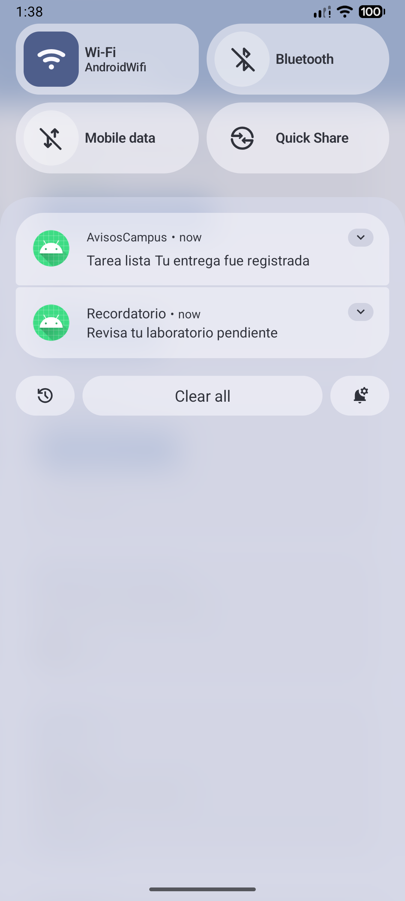
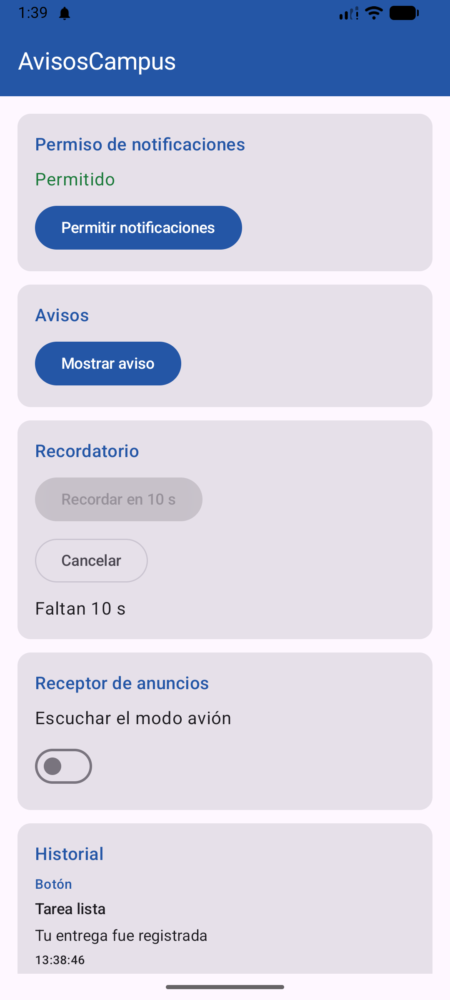
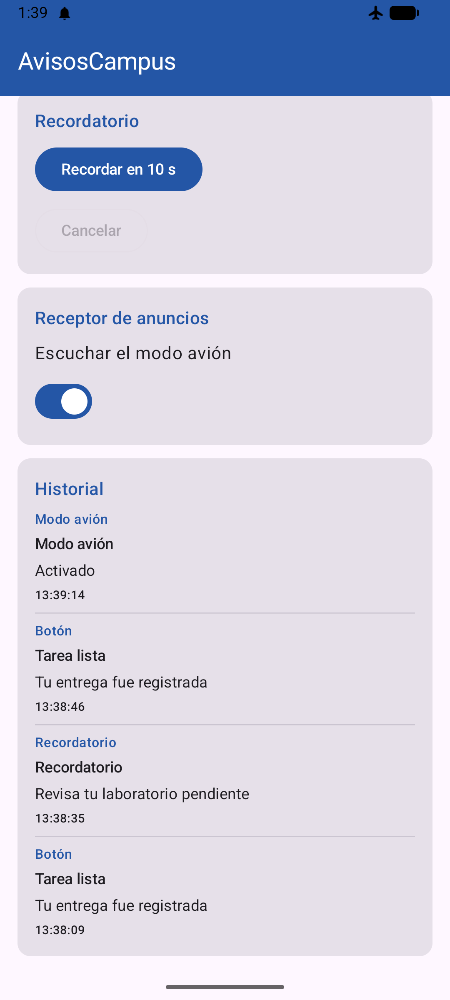
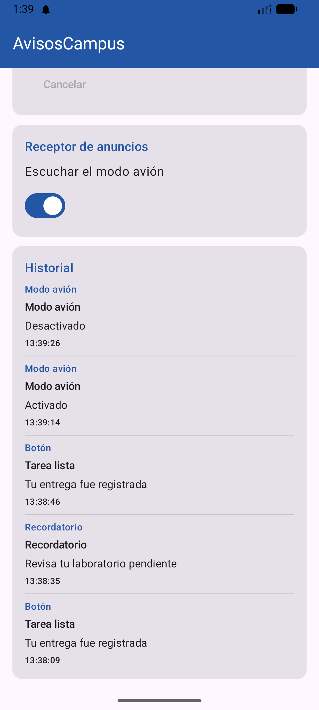
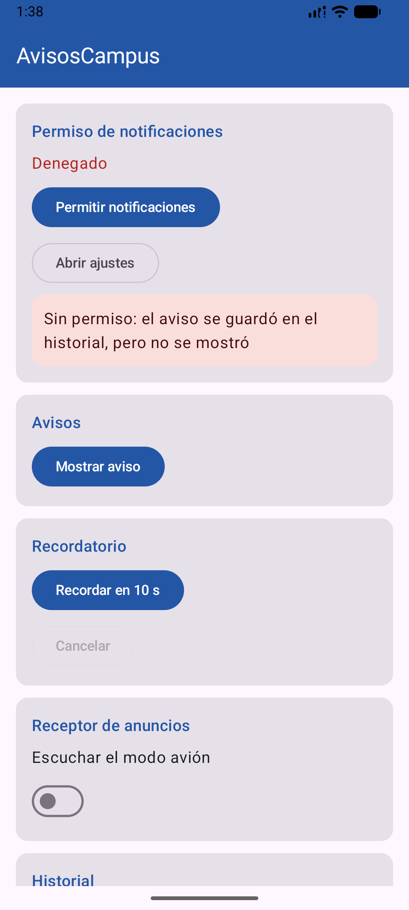

# AvisosCampus — Fase 1

Aplicación de laboratorio para practicar notificaciones locales y anuncios del sistema con
**Kotlin, Jetpack Compose y Material 3**, siguiendo **MVVM + Repository**.
Se construyó desde la plantilla de Android Studio, sin importar un proyecto con avances.
Todos los mensajes son ficticios. No utiliza un servidor, Firebase ni claves.

## Funciones

- Canal **Avisos**, creado al iniciar la aplicación.
- Solicitud de `POST_NOTIFICATIONS` en Android 13 o superior y estado visible del permiso.
- Aviso **Tarea lista / Tu entrega fue registrada** con un ID distinto por registro de la sesión.
- Apertura de la app con un `PendingIntent` inmutable y eliminación del aviso al tocarlo.
- Recordatorio de **10 segundos**, cuenta regresiva y cancelación.
- Escucha opcional de los cambios de modo avión mediante un receptor dinámico.
- Historial en memoria con origen, título, texto y hora; muestra los **20 más recientes**.
- Mensaje de error y acceso a Ajustes cuando no se puede mostrar una notificación.

## Entorno y ejecución

Configuración conservada de la plantilla: `minSdk = 24`, `compileSdk = 37`, `targetSdk = 37`,
AGP `9.4.1`, Gradle `9.6.0` y JVM del daemon `25`.
Se añadió `lifecycle-viewmodel-compose` usando la versión Lifecycle del catálogo (`2.11.1`).

1. Abrir el proyecto en Android Studio y sincronizar Gradle.
2. Configurar la ubicación del SDK en `local.properties` (no se versiona).
3. Ejecutar en un emulador o dispositivo. Usar **API 33 o superior** para probar el cuadro de permiso.
4. Pulsar **Permitir notificaciones** y después **Mostrar aviso**.

Desde la raíz del repositorio:

```sh
./gradlew :app:assembleDebug
./gradlew :app:testDebugUnitTest
./gradlew :app:connectedDebugAndroidTest
./gradlew :app:lintDebug
```

Las pruebas instrumentadas requieren un dispositivo conectado. No ejecutar al mismo tiempo
otras herramientas que utilicen `UiAutomation`, como `uiautomator dump`.
La aplicación funciona localmente; la primera sincronización sí puede necesitar descargar dependencias.

## Estructura de paquetes

Fuentes principales: `app/src/main/java/com/clemente/avisoscampus/`.

```text
com.clemente.avisoscampus/
├── AvisosApp.kt
├── MainActivity.kt
├── model/
│   └── Modelos.kt                  # Aviso, Origen y PermisoUi
├── data/
│   └── AvisosRepository.kt          # Interface e implementación en memoria
├── notificacion/
│   └── Notificador.kt              # Canal, permiso y acceso al sistema
├── receiver/
│   └── ModoAvionReceiver.kt         # Traduce el anuncio en un callback
├── viewmodel/
│   ├── AvisosViewModel.kt           # Estado, decisiones y eventos
│   └── AvisosViewModelFactory.kt
└── ui/
    ├── PantallaAvisos.kt
    ├── HistorialAvisos.kt
    └── theme/
```

El ícono monocromático está en `app/src/main/res/drawable/ic_notificacion.xml`.
Las pruebas están en `app/src/test/` y `app/src/androidTest/`.

## Diagrama MVVM

```text
Usuario ── botones / switch ──> PantallaAvisos
                                     │ llama métodos
                                     ▼
                              AvisosViewModel
                              │             │
                      registrar()           │ SharedFlow<Aviso>
                              ▼             ▼
                      AvisosRepository   PantallaAvisos
                              ▲             │ tiene Context
                              │             ▼
                 AvisosRepositoryMemoria  Notificador ──> Android

StateFlow: historial, permiso, mensaje, cuenta regresiva y estado del switch
ViewModel ────────────────────────────────────────────> PantallaAvisos

Android ──> ModoAvionReceiver ── callback ──> AvisosViewModel
```

El ViewModel solo conoce la interface del Repository: **no recibe `android.content.Context`,
`NotificationManager` ni `BroadcastReceiver`**. Registra el aviso antes de emitir el evento.
La pantalla recoge ese evento y llama al Notificador.
El receptor se registra en un `DisposableEffect` cuando el switch está activo y se retira
en su `onDispose`. `HistorialAvisos` recibe únicamente una lista y no conoce el ViewModel.

## Capturas reales

Capturadas el **25 de noviembre de 2026** en el emulador `Medium_Phone_API_37.0`.
La interfaz del sistema del emulador está en inglés; la aplicación está en español.

### 1. Notificación en el panel



### 2. Recordatorio con cuenta regresiva



### 3. Escucha del modo avión



### 4. Historial



### 5. Permiso denegado



## Validación de la fase 1

Última ejecución completa: **25 de noviembre de 2026**.

- `assembleDebug`: correcto.
- Pruebas unitarias: **5 ejecutadas, 0 fallos**.
- Pruebas instrumentadas: **10 ejecutadas, 0 fallos** en API 37.
- `lintDebug`: **0 errores, 12 advertencias**. Las advertencias restantes corresponden a
  actualizaciones de herramientas/dependencias y recursos o atributos de la plantilla;
  no se actualizó el entorno innecesariamente.

| Comprobación | Resultado / evidencia |
|---|---|
| Canal Avisos y creación repetida sin duplicarlo | Prueba instrumentada del Notificador |
| Solicitud de permiso, aceptación y rechazo | Verificado con el cuadro real del sistema |
| Dos avisos independientes | Prueba instrumentada; excluye el resumen automático del sistema |
| PendingIntent inmutable y auto-cancelación | Prueba instrumentada; apertura y desaparición verificadas desde segundo plano |
| Recordatorio y bloqueo de una segunda programación | Prueba instrumentada |
| Recordatorio con la app minimizada | Verificado: el aviso llegó al panel del sistema |
| Cancelación sin generar aviso | Prueba instrumentada |
| Modo avión encendido/apagado con escucha activa | Verificado: registros Activado y Desactivado |
| Modo avión con escucha desactivada | Verificado: no se agregaron nuevos registros |
| Historial vacío y límite de 20 | Pruebas de Compose |
| Estado e historial ante recreación de Activity | Prueba de Compose: conserva la misma instancia de ViewModel y la cuenta activa |
| Permiso denegado, historial y ausencia de cierre | Verificado en la app y pruebas del mensaje/Notificador |
| Ajustes y recuperación del permiso | Verificado con el switch de Ajustes y el botón Permitir notificaciones |
| Separación MVVM y liberación del receptor | Revisión del código |

Se probó la recreación de Activity explícitamente para comprobar la conservación del estado.
No se han ejecutado pruebas en un dispositivo físico ni en API 24–32; las rutas de compatibilidad
están protegidas por comprobaciones de versión y revisadas con Lint.

## Decisiones y límites del laboratorio

- El primer commit incluye la base creada desde cero: modelos, Repository, Factory,
  pantalla con controles deshabilitados, tema e ícono. Cada función se añadió en su paso posterior.
- Se conservó el paquete `com.clemente.avisoscampus`; no es necesario copiar el paquete de los ejemplos.
- Aunque el objetivo del historial diga «todos», se siguió el contrato más concreto: `take(20)`.
- El recordatorio usa `viewModelScope`, no un servicio ni un planificador persistente.
  Continúa con la Activity minimizada mientras el proceso siga vivo; no garantiza una alarma exacta
  si el sistema suspende la ejecución, termina el proceso o el usuario cierra la Activity definitivamente.
- El historial sobrevive a la recreación de Activity gracias al ViewModel, pero no a la muerte del proceso.
  Los IDs son distintos dentro de cada instancia del Repository; al iniciar otra sesión vuelven a comenzar
  y podrían reemplazar notificaciones anteriores que sigan visibles. Se conserva así el Repository de la guía.
- Se mantiene el `SharedFlow` sin replay del documento. Un evento emitido justo cuando no haya
  pantalla suscrita puede perderse, aunque el aviso ya esté guardado en el historial. No es una cola persistente.
- Después de conceder el permiso en Ajustes, pulsar **Permitir notificaciones** actualiza la etiqueta
  y limpia el mensaje, como pide el contrato. No se añadió sincronización automática al volver de Ajustes.
- Además del permiso, se comprueba si las notificaciones o el canal están bloqueados. El mensaje
  de error conserva el texto literal solicitado por la guía.
- En API 26+ se abre la pantalla de notificaciones; en API 24–25 se abre la ficha de la aplicación.
- Solo se ha realizado la **fase 1**. No hay persistencia, canales adicionales, Firebase ni rama `mejora-ia`.

## Para pensar

### 1. ¿Por qué necesita un canal y un permiso? ¿Qué pasa si falta cada uno?

Desde Android 8, el canal agrupa avisos y permite al usuario controlar su importancia, sonido y bloqueo.
Para una app con un target moderno, una notificación sin canal válido no se muestra en esas versiones.
Desde Android 13, `POST_NOTIFICATIONS` autoriza las notificaciones ordinarias de la aplicación:
declararlo no basta, también hay que solicitarlo en ejecución. Si está denegado, el aviso de este
laboratorio no se muestra, pero la aplicación lo conserva en el historial y explica lo ocurrido.
El permiso concedido tampoco evita que el usuario bloquee un canal en Ajustes.

### 2. ¿Por qué el ViewModel emite un evento en lugar de mostrar la notificación?

El ViewModel decide qué ocurrió y registra el aviso, sin depender del sistema de notificaciones ni de
un Context de Activity. La pantalla transforma el evento en la llamada al Notificador. Así se separan
las responsabilidades y se puede probar la lógica usando un Repository sustituible.

### 3. ¿Qué pasa si se usa el mismo ID en dos notificaciones?

Con el mismo paquete y tag, una llamada posterior a `notify` con el mismo ID actualiza o reemplaza
la notificación anterior. IDs diferentes permiten mantener avisos individuales simultáneamente.
El sistema puede agruparlos visualmente, lo cual no significa que tengan el mismo ID.

### 4. ¿Por qué onReceive debe ser corto y por qué quitar el receptor al salir?

`onReceive` tiene un tiempo limitado y normalmente se ejecuta en el hilo principal. Realizar trabajo
largo puede bloquear la app y provocar un ANR. Este receptor solo valida la acción y comunica un booleano.
Desregistrarlo al abandonar su ámbito evita mantener referencias a un Context que ya no corresponde
y evita recibir eventos cuando esa parte de la interfaz ya no debería escucharlos.

### 5. ¿Cuándo usar una notificación local y cuándo una push de Firebase?

Una notificación local sirve cuando el dispositivo ya conoce el evento: un botón, un cambio del sistema
o un recordatorio. Una push sirve cuando la información llega desde fuera, por ejemplo un anuncio nuevo
publicado por el campus. Firebase Cloud Messaging transporta esos mensajes; no está implementado aquí.
Una push no reemplaza las comprobaciones del permiso ni la configuración del canal.

## Historial de commits

1. `chore: crea proyecto base AvisosCampus`
2. `feat(notificacion): crea el canal Avisos en la clase Application`
3. `feat(permiso): pide POST_NOTIFICATIONS y muestra su estado`
4. `feat(notificacion): muestra la notificacion con NotificationCompat`
5. `feat(notificacion): abre la app al tocar con PendingIntent`
6. `feat(recordatorio): cuenta regresiva con corrutina y cancelacion`
7. `feat(receptor): escucha el modo avion con BroadcastReceiver`
8. `feat(ui): agrega historial de avisos`
9. `feat(errores): maneja el permiso de notificaciones denegado`
10. `docs: agrega README con estructura y capturas`

El repositorio local utiliza `main`. La publicación está pendiente de configurar un remoto elegido
por el propietario; no se ha creado ningún repositorio externo ni realizado un push.